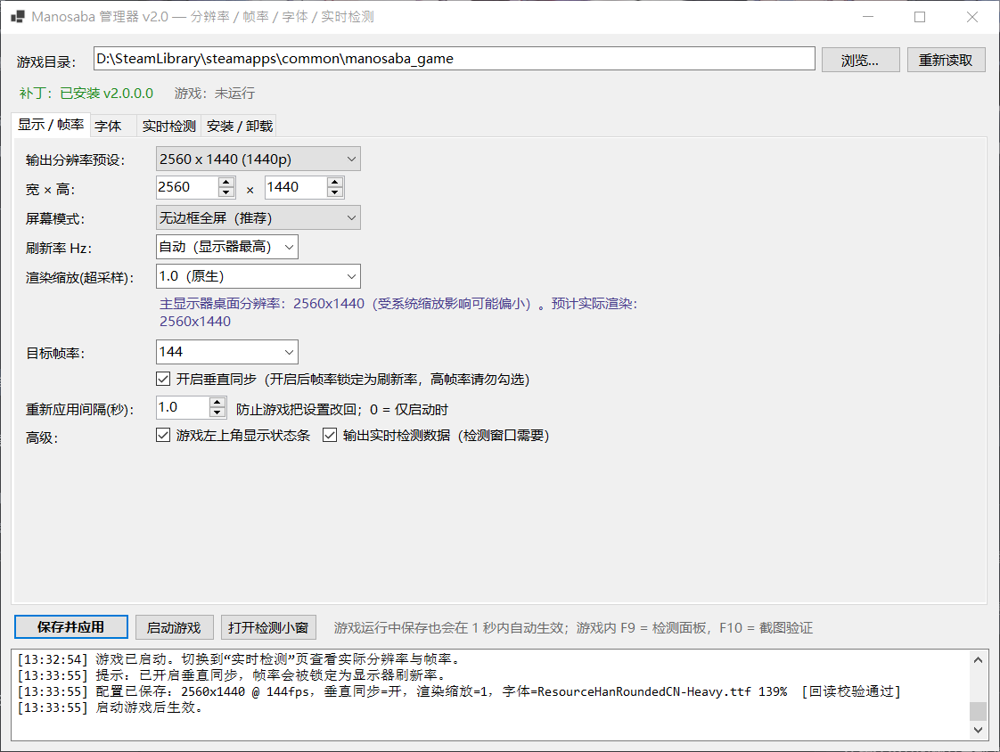
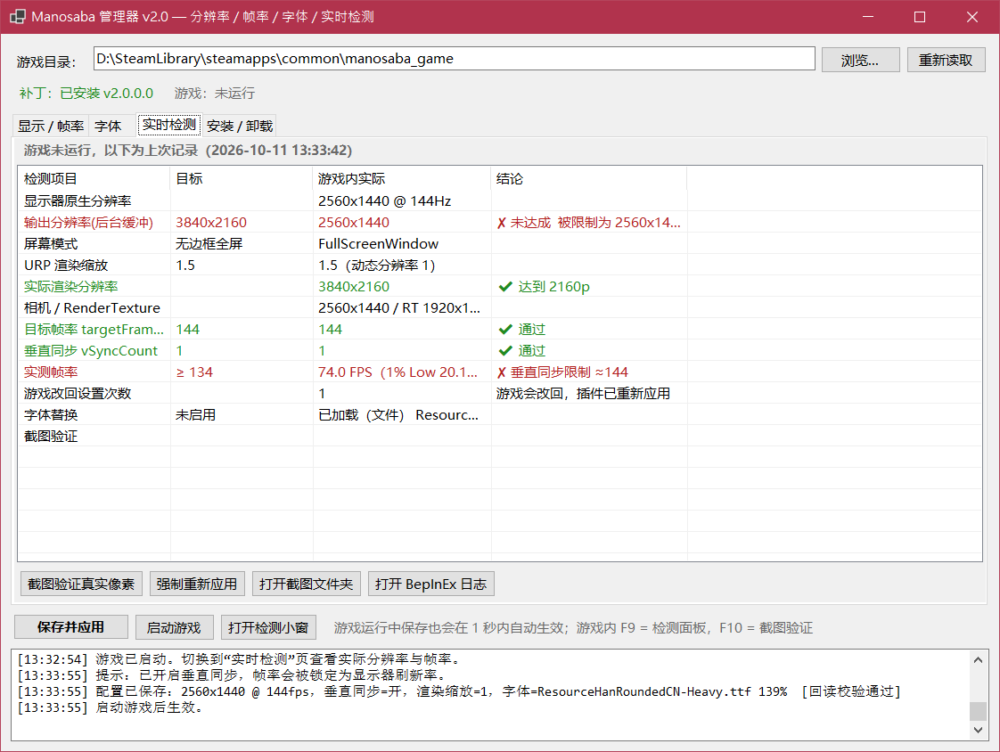
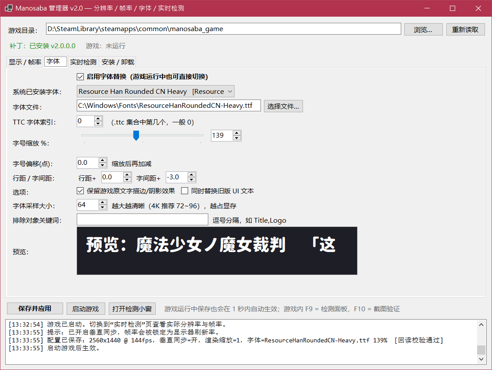
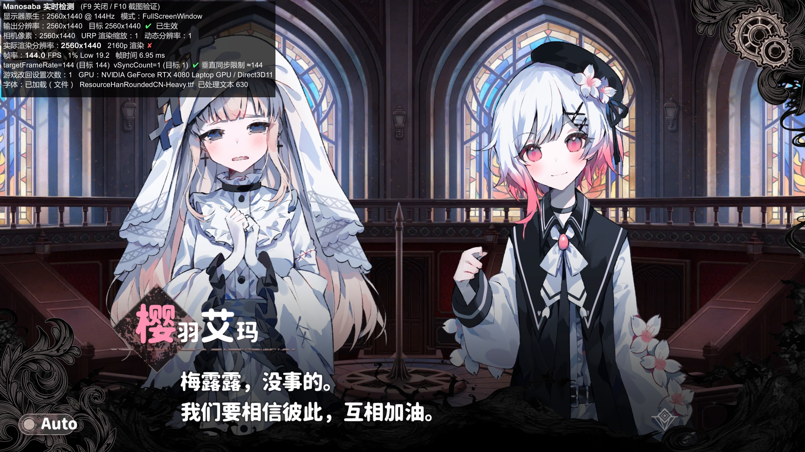
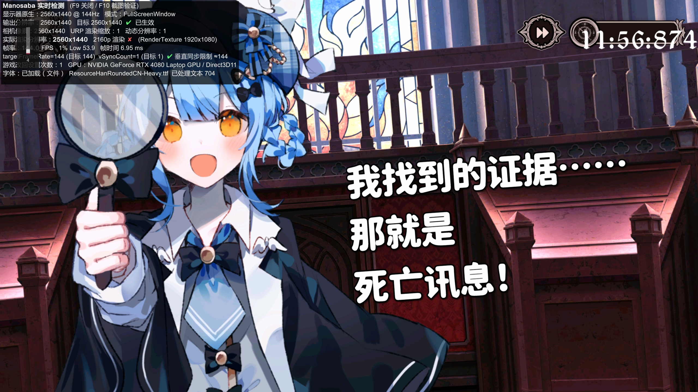
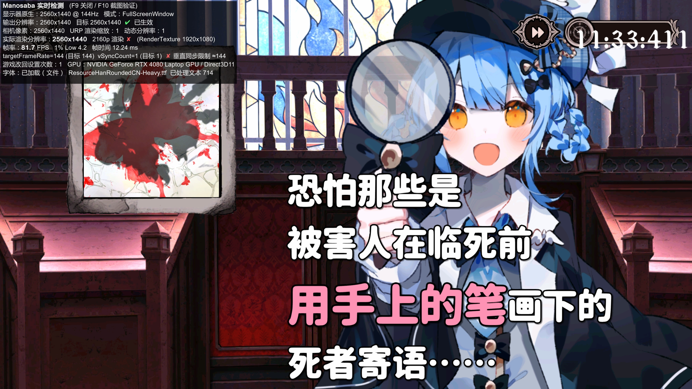

# Manosaba 整合版补丁

《魔法少女ノ魔女裁判》（manosaba，Steam AppID 3101040）的**分辨率 / 帧率解锁 + 实时检测 + 自定义字体**补丁，一个管理器全部搞定。

基于 BepInEx 6，在游戏运行时加载插件，**不修改任何游戏原始文件**，卸载后游戏完全恢复原样。适用于 Unity 6 IL2CPP 版。

**[⬇ 下载最新版](../../releases/latest)**（`Manosaba-Patch-vX.X.zip`）

<table>
<tr>
<td></td>
<td></td>
</tr>
<tr><td align="center">显示 / 帧率设置</td><td align="center">实时检测：逐项对比目标与实际</td></tr>
<tr>
<td></td>
<td></td>
</tr>
<tr><td align="center">自定义字体、字号、行距</td><td align="center">游戏内：换成圆体字 + 检测面板（F9）</td></tr>
<tr>
<td></td>
<td></td>
</tr>
<tr><td align="center">2560×1440 @ 144 FPS</td><td align="center">左上角实时显示分辨率、帧率、1% Low</td></tr>
</table>

## 功能

- **分辨率**：任意输出分辨率、无边框全屏 / 窗口 / 独占全屏、刷新率。
- **渲染缩放（超采样）**：1440p、1080p 显示器也能真正以 2160p 内部渲染。
- **帧率解锁**：60 / 120 / 144 / 165 / 240 或不限制；游戏改回设置时自动重新应用。
- **实时检测**：管理器「实时检测」页、置顶检测小窗、游戏内 F9 面板。可以查看输出分辨率、实际渲染分辨率、帧率、1% Low、帧时间、垂直同步是否被游戏改回；F10 截图验证真实像素。
- **自定义字体**：系统字体或任意 .ttf/.otf/.ttc，字号缩放、行距、字间距，保留游戏原描边。新字体缺的字自动用原字体显示。
- **热重载**：游戏开着改设置，1 秒内生效。
- 管理器自带运行库，不用另外装 .NET；能自动从 Steam 库找到游戏目录。

## 安装

1. 从 [Releases](../../releases/latest) 下载 zip，把里面的「Manosaba整合版补丁」文件夹解压到游戏目录里，和 `manosaba.exe` 放在同一层。例如 `...\steamapps\common\manosaba_game\Manosaba整合版补丁`。
2. 双击「Manosaba管理器.exe」→「安装 / 卸载」页 →「安装 / 更新补丁」，或者直接双击「安装.bat」。
3. 用管理器的「启动游戏」，或者直接双击 `manosaba.exe` 启动。左上角出现「Manosaba | 输出 … | 渲染 … | FPS」状态条，说明补丁已加载。

> **首次启动需要联网，会比平时慢一些**：BepInEx 会根据你电脑上的游戏自动生成 `BepInEx\interop`，并下载 Unity 基础库 `BepInEx\unity-libs`。这些文件和游戏代码相关，所以没有放进补丁包。

> 从 Steam「开始游戏」启动时，Steam 游戏内界面可能让补丁不加载。如果要从 Steam 启动：库 → 右键游戏 → 属性 → 通用 → 取消勾选「在游戏中启用 Steam 界面」。

### 分辨率怎么选

实际渲染分辨率 = 输出分辨率 × 渲染缩放

| 显示器 | 输出分辨率 | 渲染缩放 | 内部渲染 |
|---|---|---|---|
| 4K | 3840×2160 | 1.0 | 2160p |
| 1440p | 2560×1440 | 1.5 | 2160p |
| 1080p | 1920×1080 | 2.0 | 2160p |

想要高帧率时不要开垂直同步。如果帧率还是被锁在 60，到显卡控制面板里把这个游戏的垂直同步设为「关」或「应用程序控制」。

## 卸载

管理器「安装 / 卸载」页 →「卸载补丁」，或者运行「卸载.bat」。只删除补丁自己添加的文件。

## 推荐字体

截图里用的是 **资源圆体 Resource Han Rounded CN Heavy**（SIL OFL 1.1），可以到作者页面下载：<https://github.com/CyanoHao/Resource-Han-Rounded>。中文也推荐微软雅黑、思源黑体/宋体、霞鹜文楷、HarmonyOS Sans、MiSans。

## 说明

- 插件和管理器由 nangongyuyou 制作，免费使用。用到的开源组件（BepInEx、Unity Doorstop、HarmonyX、Il2CppInterop、.NET 运行时等）见压缩包里的「第三方组件说明.txt」。
- 《魔法少女ノ魔女裁判》及截图中的游戏画面版权归开发商和发行商所有。本补丁与他们无关，只用于在本机调整显示效果。**请支持正版。**
